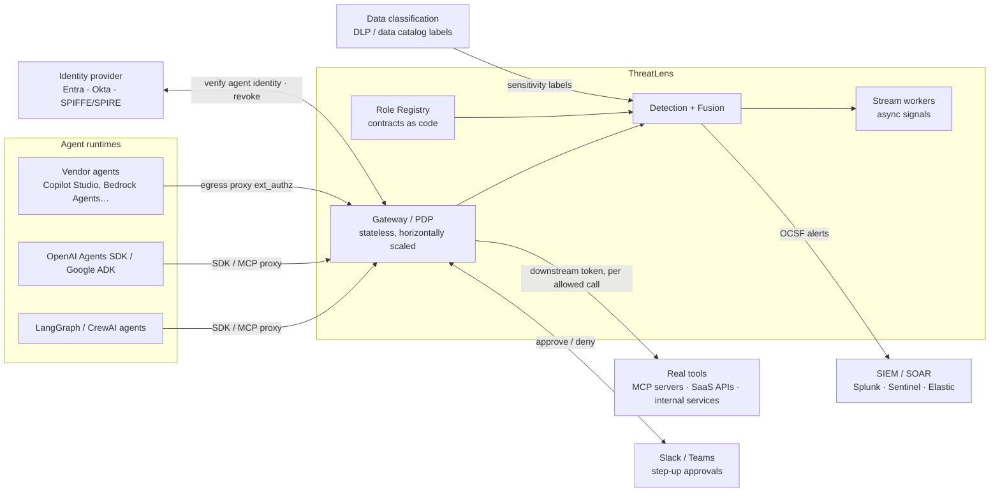

# ThreatLens AI — Production & Real-World Deployment

The hackathon build runs on free tiers against a simulated enterprise. This document explains **how the same system runs inside a real company**: what plugs into what, how it scales, how it fails safely, and how a security team rolls it out without breaking their agents.

> **Design rule: production-shaped, not demo-shaped.** Every place where the hackathon uses something simulated sits behind a small adapter with the same interface its production replacement would use. Going to production means swapping adapters, not rewriting modules.

---

## 1. Where ThreatLens sits in a real enterprise

### 1.1 Three integration modes (customers pick per agent)

| Mode | How it connects | Enforcement | When to use |
|------|----------------|-------------|-------------|
| **Inline SDK** | `@guarded_tool` decorator or callback hook in LangGraph, CrewAI, OpenAI Agents SDK, Google ADK, and similar frameworks | Full: allow, restrict, step-up, isolate | Agents the company builds itself |
| **MCP / egress proxy** | ThreatLens runs as an MCP proxy in front of MCP tool servers, or as an **Envoy `ext_authz`** policy service on the agents' egress proxy | Full, with no code changes to the agent | Third-party or vendor agents the company can't modify |
| **Passive telemetry** | Ingest OpenTelemetry spans (GenAI semantic conventions) or tool-server audit logs | Detect + explain. Containment happens through **IdP token revocation** or a SOAR playbook. | Quick start, or for agents where inline enforcement isn't allowed yet |

### 1.2 The gateway must be the only path (bypass prevention)

Detection is useless if a hijacked agent can call tools directly. In production:

1. **Tools don't accept agent tokens.** For each allowed call, the gateway exchanges the agent's token for a **short-lived downstream token** (OAuth 2.0 Token Exchange, RFC 8693) that is scoped to exactly that tool and resource. Tools only trust tokens issued by the gateway.
2. **Network policy:** agent workloads can only reach the gateway and the LLM endpoint. Tool services only accept traffic from the gateway (Kubernetes NetworkPolicy or a service mesh with mTLS).
3. **Delegation uses RFC 8693's `act` (actor) claim,** so the full agent chain is carried inside the token itself and can be verified at every hop.

> **Hackathon:** the gateway mints downstream tokens, and the mock tools reject agent tokens. Scenario **A7 (bypass attempt)** shows a hijacked agent calling a tool directly and getting refused.

---

## 2. Production adapters (the seams)

Each module talks to the outside world through one of these adapters. In the hackathon each adapter has exactly one implementation. These are the swap points, not extra layers.

| Adapter | Hackathon implementation | Production implementation |
|---------|--------------------------|---------------------------|
| `IdentityProvider` | Local JWT issuer (PyJWT) | Microsoft Entra / Okta workload or agent identities, or SPIFFE/SPIRE SVIDs. Revocation through the IdP API. |
| `ToolConnector` | Mock enterprise FastAPI app | Real MCP servers, SaaS APIs, internal services, called with gateway-minted downstream tokens |
| `SensitivityLabeler` | Labels in a YAML file tree | Labels from the company's DLP or data catalog (for example, classification tags on files, tables, buckets) |
| `EventSink` | MongoDB Atlas | Kafka / Redpanda topic → ClickHouse for analytics. Raw events go to object storage. |
| `StateStore` | In-process dicts + Mongo | Redis Cluster (per-session taint sets, CUSUM state, Markov counts), sharded by `agent_id` |
| `RegistryStore` | Mongo + YAML in repo | Postgres (contracts, amendments, alerts, audit). Contracts live in git as code. |
| `Notifier` | Discord webhook / Resend | Slack / Teams with interactive approve/deny, PagerDuty, Jira / ServiceNow tickets |
| `AlertExporter` | JSON download | **OCSF** events to SIEM (Splunk HEC, Microsoft Sentinel, Elastic). SOAR webhooks. |
| `LLMProvider` | Free router (Groq, Gemini, OpenRouter, Ollama) | Company-approved model endpoint (Azure OpenAI, Bedrock, Vertex, or self-hosted) with zero data retention |
| `ModelStore` | Files in `models/` | Model registry (MLflow or similar) with versions, approvals, rollback |

---

## 3. Scaling the hot path

### 3.1 Sync vs async signals

A tool call should not wait for heavy analysis. Signals are split by cost:

| Path | Signals | Budget | How |
|------|---------|--------|-----|
| **Synchronous** (inline with the tool call) | S0 runtime, S1 role conformance (cached embeddings), S2 Markov, S4 taint lookup, S5 sensitivity/egress, S6 delegation, S8 canary, fusion, PDP | **p99 < 30 ms** in-region | O(1) lookups against Redis state plus a cached embedding. No network calls except Redis. |
| **Asynchronous** (stream workers, ≤ 1 s behind) | S3 session Isolation Forest, S7 CUSUM/JSD, content scanning of large documents, fleet immunity matching | Seconds | Kafka consumers. When an async signal crosses a threshold, it **raises the agent's tier**, so the *next* action is already restricted. |

Content scanning is also triggered when content is *read*, before the agent can act on it. That's why the slow models usually finish before the risky action arrives.

### 3.2 Reference sizing (target, to be validated by load test)

| Scale | Agents | Actions/sec | Gateway | State | Events |
|-------|--------|-------------|---------|-------|--------|
| Pilot | 50 | 20 | 2 pods | 1 Redis | Postgres + ClickHouse (single node) |
| Mid-size enterprise | 2,000 | 500 | 4–6 pods (HPA on CPU + p99) | Redis Cluster 3 shards | Kafka 3 brokers, ClickHouse 2 replicas |
| Large enterprise | 20,000+ | 5,000+ | 20+ pods, multi-region | Redis Cluster per region | Kafka per region, ClickHouse cluster |

The gateway is stateless, and all per-agent state is keyed by `agent_id` in Redis. So the gateway scales horizontally, and stream workers partition by `agent_id`.

> **Hackathon:** we run a small load test (Locust or k6, both free) against the Docker Compose stack and report measured throughput and p95. We claim only those numbers.

---

## 4. Failure modes & safe degradation

| Failure | Behavior |
|---------|----------|
| Detection engine down | Gateway falls back to **static Role Contract enforcement** (tools, scopes, sensitivity ceiling). Sensitive resources fail closed, everything else fails open with logging. Configurable per role. |
| Redis down | Fall back to per-pod local state with a short TTL. Alert the on-call. Taint sets are rebuilt from the event stream. |
| Kafka / stream workers lagging | Sync signals still enforce. Async signals catch up. Lag shows on the status page. |
| LLM provider down | Detection is unaffected (no LLM in the hot path). Narratives use the template fallback. |
| IdP unreachable | Cached JWKS keys keep verification working. Revocation is queued and retried. Isolated agents stay blocked at the gateway in the meantime. |
| Bad model release (false-positive spike) | **Champion/challenger:** new models run in shadow first. One-click rollback via the model registry. An alert-budget breach auto-pauses the model's enforcement. |

**SLOs:** gateway availability 99.95%, sync decision p99 < 30 ms, alert to SIEM < 5 s, isolation applied < 2 s after decision.

---

## 5. Rolling it out at a real company

Security teams don't flip a new enforcement layer on overnight. ThreatLens is built for a staged rollout:

| Stage | Duration | What happens | Exit criteria |
|-------|----------|--------------|---------------|
| **0. Inventory** | Days | Discover agents (from IdP, MCP server logs, cloud audit logs). Draft Role Contracts with the AI drafter. Owners review them in git. | Every agent has a reviewed contract |
| **1. Shadow mode** | 1–2 weeks | Gateway observes and scores but **never blocks**. Baselines and per-role thresholds are learned. Analysts label alerts. | Alert volume within the team's **alert budget** (e.g., ≤ 5/day per role). Red-team suite passes. |
| **2. Enforce Restrict** | 1 week | Turn on scope snap-back for low-risk roles first. Step-up and Isolate stay in shadow. | Legit-work-preserved ≥ 99% |
| **3. Full enforcement** | Ongoing | Step-up approvals in Slack/Teams. Isolate auto-applies above 90 for confirmed patterns (canary hit, sensitive read + unknown egress). | Weekly tuning review |

`enforcement_mode: shadow | enforce` is a per-role setting in the Role Contract. **The hackathon build supports it too**, and the console shows what *would* have been blocked in shadow mode.

---

## 6. Keeping detection accurate over time (ML ops)

- **Feedback loop:** analyst labels (*harmless*, *confirmed attack*, *approved change*) are stored with each alert. Fusion weights and per-role thresholds retrain weekly from them.
- **Threshold calibration by alert budget:** each role's thresholds are set to the lowest value that keeps alerts within the agreed daily budget on the last 14 days of clean traffic.
- **Detector drift monitoring:** the population stability index (PSI) on each signal's score distribution flags when a signal's behavior changes, for example after a framework upgrade changes tool names.
- **Detection-as-code:** scenarios A1–A7 and B1–B2 run as a **regression suite in CI** (GitHub Actions) on every model or rule change. A release that misses a known attack or alerts on a control scenario doesn't ship.
- **Red-team refresh:** new injection techniques from public research and from the fleet signature feed are added to the suite monthly.

---

## 7. Security, privacy & compliance

### 7.1 Protecting ThreatLens itself

| Threat | Control |
|--------|---------|
| Gateway bypass | Downstream token exchange + network policy (§1.2) |
| Tampering with Role Contracts | Contracts live in git with required review (CODEOWNERS). The registry only loads **signed** contract versions. Agents can never amend their own role. |
| Baseline poisoning (slow drift) | Anchored baselines that only update from approved or aged clean windows |
| Explainer prompt injection | The LLM receives structured evidence only, with decoded snippets as quoted data |
| Insider abuse of the console | SSO + MFA for analysts, RBAC (viewer, analyst, approver, admin), every action in an append-only audit log |
| Secrets | KMS-managed signing keys, short-lived tokens, mTLS between services |

### 7.2 Privacy by design

- **Store metadata, not payloads.** Events keep tool name, resource ID, sensitivity label, byte counts, destination, and an **args digest**. Raw arguments are captured only at MONITOR or above, with PII redacted before storage.
- **Content snapshots** keep a hash, the detected techniques, and the decoded injection snippet. The full document stays in the customer's own storage.
- Configurable retention per collection. Regional data residency (EU and US deployments).
- Single-tenant deployment option. Cross-customer "fleet immunity" shares only **hashes and simhashes** of malicious content, and is opt-in.

### 7.3 Compliance alignment

| Framework | How ThreatLens helps |
|-----------|---------------------|
| **NIST AI RMF** | Govern (role contracts, owners) · Map (agent inventory) · Measure (drift metrics, evaluation) · Manage (containment, feedback) |
| **ISO/IEC 42001** (AI management systems) | Documented controls, monitoring, and incident records for AI systems |
| **EU AI Act** | Logging/record-keeping and human-oversight evidence (step-up approvals, audit trail) where agents fall under high-risk use |
| **SOC 2** | Continuous monitoring and incident response evidence |
| **OWASP Top 10 for LLM Apps** · **MITRE ATLAS** | Every alert is tagged with the matching risk/technique (e.g., LLM01 Prompt Injection, LLM06 Excessive Agency, AML.T0051) |

> These are **alignment** claims (ThreatLens produces evidence that supports these controls), not certification claims.

---

## 8. Operating it day to day

- **Dashboards:** fleet trust, alerts per role vs budget, gateway p99, stream lag, model versions in shadow vs enforce.
- **Metrics endpoint:** Prometheus `/metrics` (decisions by tier, signal latency, cache hit rate). It's included in the hackathon build.
- **Runbooks:** "Agent isolated", "False-positive spike", "Gateway latency SLO breach", "IdP revocation failing". Each has the console's deep links.
- **On-call:** PagerDuty for ISOLATE on production-critical agents. Everything else goes to a ticket queue.

---

## 9. Hackathon → production mapping (put this on a slide)

| Real-world piece | Hackathon stand-in | Same interface? |
|------------------|-------------------|-----------------|
| Corporate agents on LangGraph/CrewAI/etc. | Python agents on the free LLM router + replay simulator | ✅ SDK |
| Okta / Entra / SPIFFE agent identity | Local JWT issuer | ✅ `IdentityProvider` |
| MCP servers & SaaS APIs | Mock enterprise FastAPI | ✅ `ToolConnector` |
| DLP / catalog sensitivity labels | YAML labels | ✅ `SensitivityLabeler` |
| Kafka + ClickHouse + Redis + Postgres | MongoDB Atlas M0 + in-process state | ✅ `EventSink` / `StateStore` / `RegistryStore` |
| SIEM / SOAR / Slack approvals | OCSF JSON export, Discord webhook, console approvals | ✅ `AlertExporter` / `Notifier` |
| Kubernetes, multi-AZ | Vercel (web) + Render free (API, Docker) | Docker images are the same |

**What's genuinely real in the hackathon build:** the gateway enforcement, all detection signals, fusion, explanations, containment, token exchange and bypass prevention, shadow/enforce modes, the CI regression suite, and the measured evaluation. Only the *environment* is simulated.
